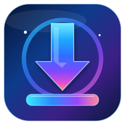

<div align="center">
  
  <h1>HyperGet</h1>
  <p>A desktop download manager for Windows, developed in Kotlin and Compose.</p>
</div>

## HyperGet

**HyperGet** is our download manager built to provide reliable downloads, configurable queues, useful desktop tools, and a responsive Windows interface. Its main product name, launcher, installer, shortcuts, Start Menu and Windows app listing use **HyperGet**.

The GitHub repository retains the historical URL `amroalhamedi2022-hue/personal-download-manager` so existing source links remain valid. Internal data-directory, package and browser native-messaging identifiers also retain compatibility with earlier installations.

## Current development features

- HTTP/HTTPS downloads with pause/resume, segment management and recovery mechanisms.
- Download queues, categories, search by filename or link, and configurable sortable columns.
- Multi-link paste and drag-and-drop text/Windows shortcut files, with bounded decoding and corrupt-input rejection.
- FTP/HLS handling, download speed controls and preferences.
- Windows installer and automated checks for download integrity, GUI behaviour and uninstall safety.

Some functions remain under development or require additional human acceptance (particularly browser-integration compatibility, full Windows DPI/RTL review, real Explorer multi-file drop and sustained large-download loads). Passing CI does not mean all features are complete.

### aria2 status

The `aria2` investigation includes a tested experimental process/RPC adapter and Windows performance comparison on the development branches. **It is not currently the active production download engine in `main`, is not bundled in this installer and is not enabled in the user interface.** The current engine remains in use until adapter wiring and compatibility/rollback acceptance are completed. The user approved retaining aria2's BitTorrent capability for the eventual integration; this does not mean Torrent downloads are active in the currently distributed application.

## Windows development builds

Windows CI compiles the application, tests its Kotlin modules, creates the installer, and checks safe silent install/uninstall. See [GitHub Actions](https://github.com/amroalhamedi2022-hue/personal-download-manager/actions) for builds from specific commits. Choose a successful workflow and its `hyperget-windows-x64` artifact. Development artifacts are not a signed final release.

To build from source, use the repository's Gradle wrapper with the documented JetBrains Runtime toolchain. For Windows development:

```powershell
.\gradlew.bat --no-daemon :downloader:core:desktopTest :shared:app:desktopTest :desktop:app:compileKotlin
.\gradlew.bat --no-daemon createReleaseFolderForCi
```

## Compatibility and migration

The Windows graphical launcher is `HyperGet.exe`, the installer builder produces `HyperGetSetup.exe`, and visible shortcuts use **HyperGet**. The updater and existing browser integrations may still rely on old *internal* executable/registry IDs. Their aliases and persistence paths must remain stable until compatibility migrations are tested.

## Project work and roadmap

- [Main integration checkpoint](docs/handoffs/HYPERGET_MAIN_INTEGRATION_CURRENT.md)
- [Execution plan](docs/Download_Manager_Execution_Plan_v1.md)
- [aria2 evaluation and migration plan](docs/ARIA2_CORE_MIGRATION_PLAN_2026-10-27.md) (on development branches)

## Open-source acknowledgement

HyperGet is based on [AB Download Manager](https://github.com/amir1376/ab-download-manager), licensed under the [Apache License 2.0](LICENSE). We preserve the upstream attribution and licence; the project's current name is **HyperGet**, not the upstream project's name.

No downloaded executables, icons, or project branding should be mistaken for those of Internet Download Manager (IDM); IDM is used only as a feature-comparison reference.
